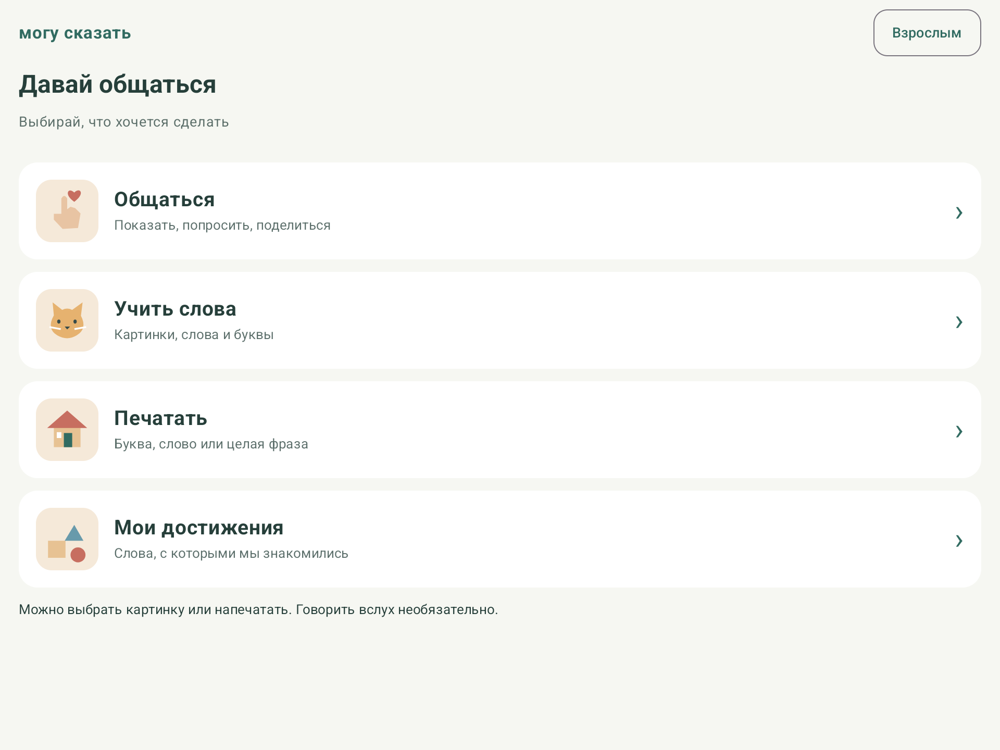
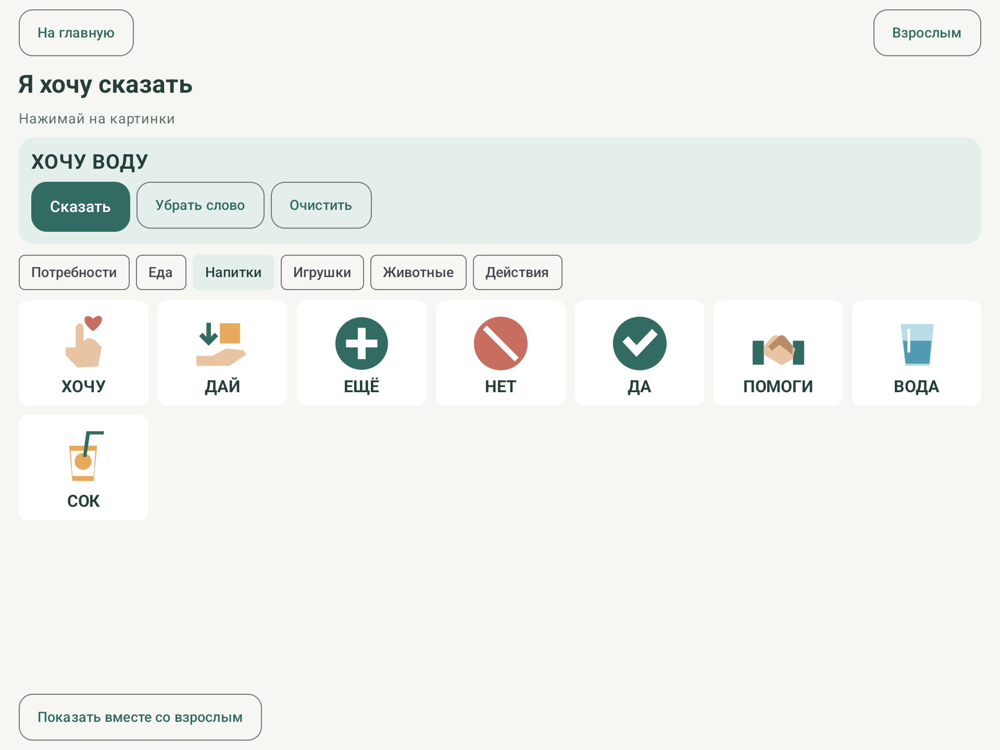
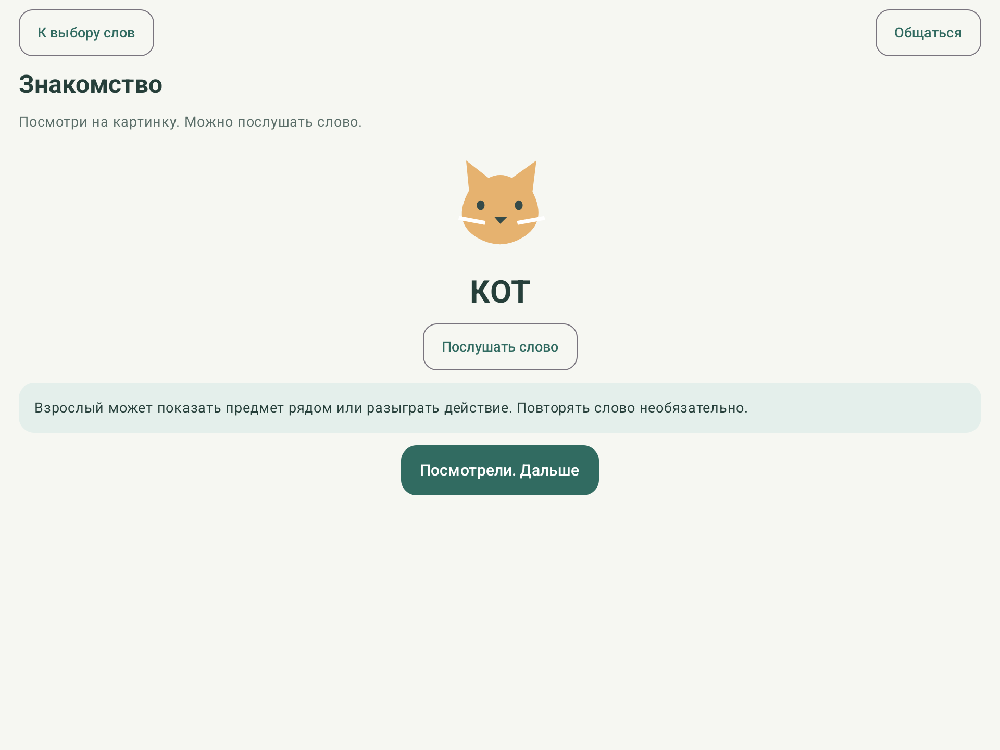
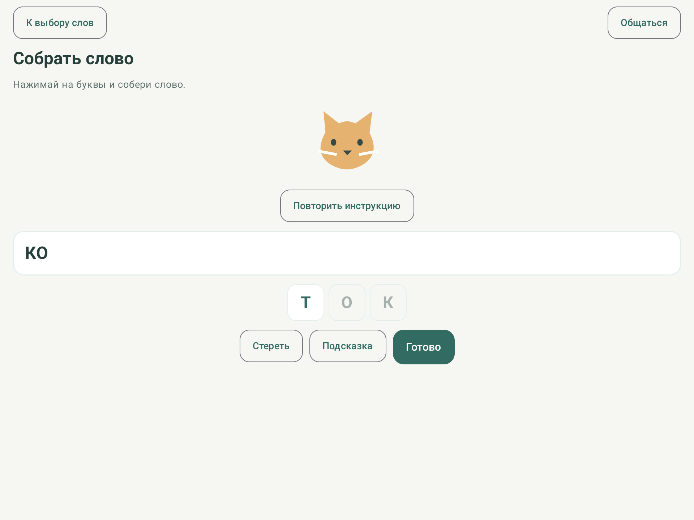
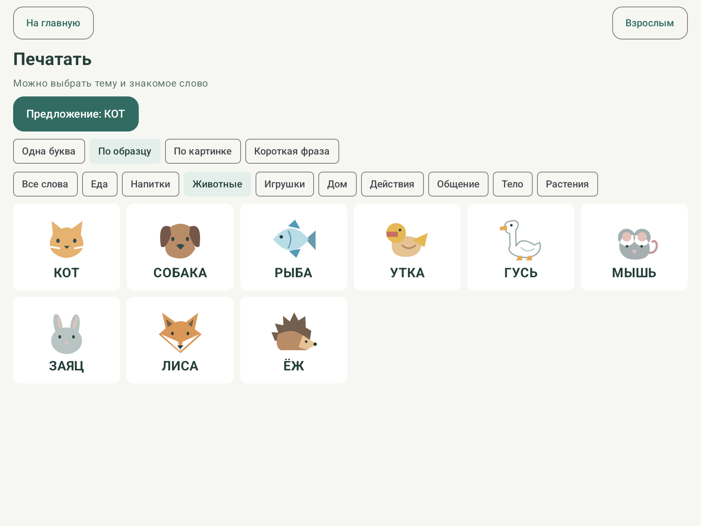
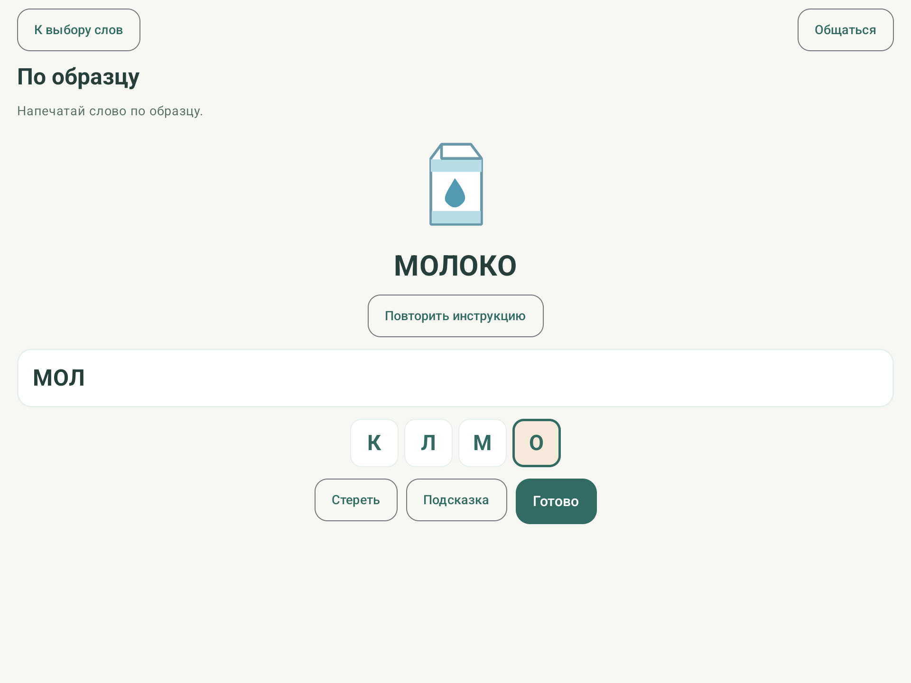
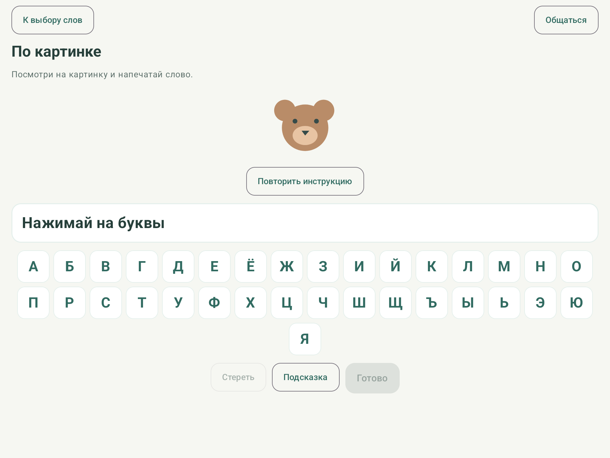
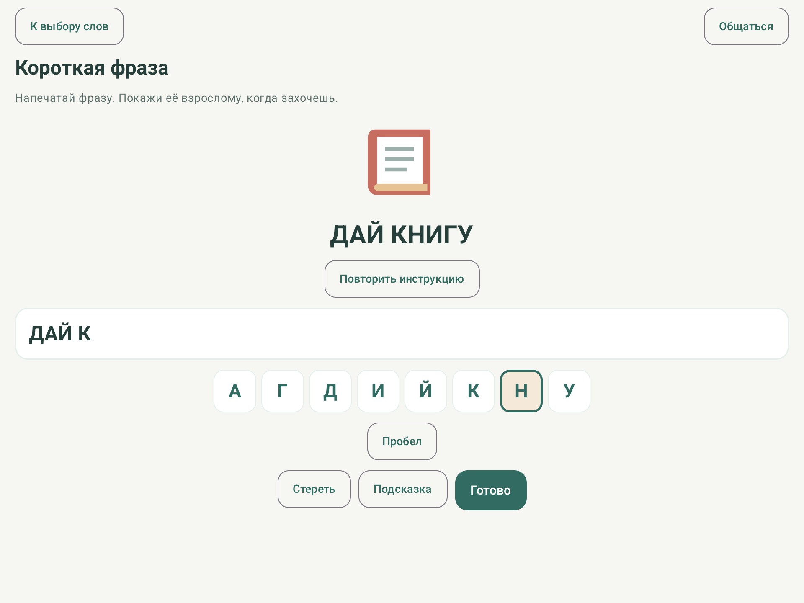
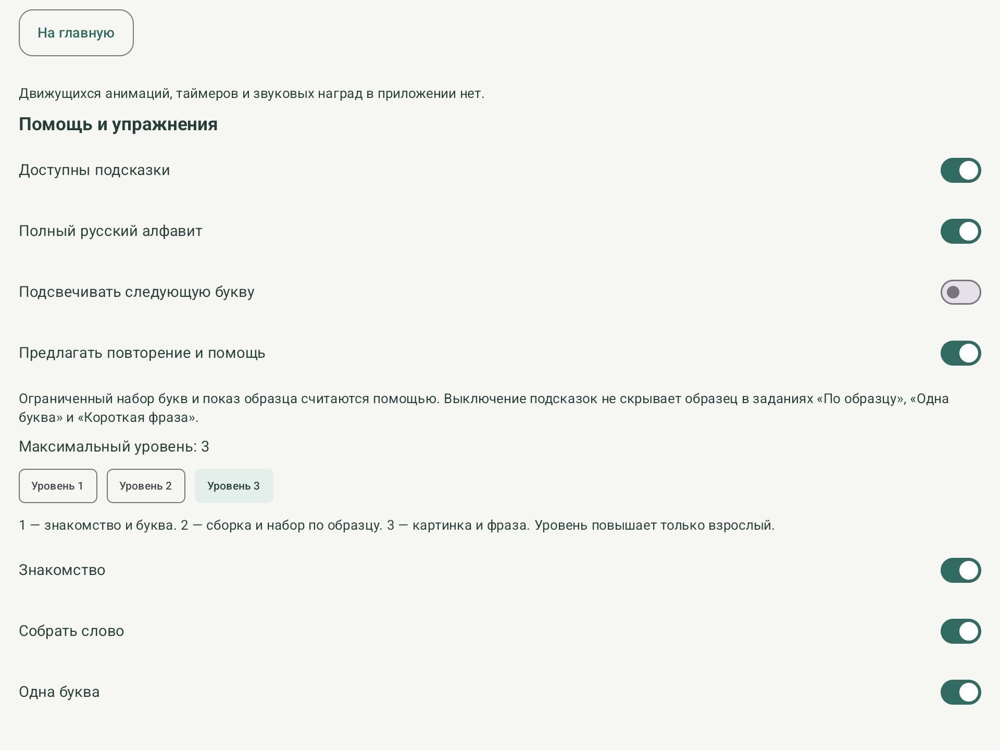
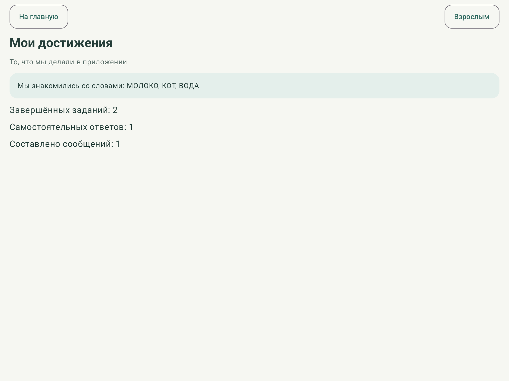

# Могу сказать

**Версия 0.2.0 · Android 8.0+ · Kotlin / Jetpack Compose · MIT**

Android-приложение для совместного общения с помощью карточек и знакомства с письменной речью. Основной язык — русский. Предназначено для планшетов Android 8.0 и новее.

Это образовательный и вспомогательный инструмент, не медицинское изделие, средство диагностики или замена логопеда. Успешное общение важнее учебного результата. Говорить вслух необязательно.

## Возможности

- «Общаться»: 22 коммуникационные карточки, шесть категорий, постоянная группа функциональных слов, короткие фразы и показ взрослого. «ХОЧУ ВОДУ», «ДАЙ МЯЧ», «ЕЩЁ ИГРАТЬ».
- «Учить слова»: рисунок, написанное слово и озвучивание; сборка букв нажатием.
- «Печатать»: своя клавиатура, 50 слов по образцу и картинке, 12 коротких фраз и задания на отдельную букву. Ограниченный набор либо все 33 буквы.
- Выбор темы: еда, напитки, животные, игрушки, дом, действия, общение, тело и растения. Каждое учебное слово также доступно для знакомства и сборки из букв.
- Локальный профиль, история, отметки помощи, самостоятельные результаты, настройка уровня и выбора упражнений.
- 50 учебных слов и 216 упражнений в JSON; авторские векторные иллюстрации без внешних графических зависимостей.
- Русский Android TTS с установленным голосом без сети. Если голоса нет, задания и визуальная коммуникация доступны, взрослый видит пояснение.

Регистрация, сервер, реклама, аналитика и микрофон отсутствуют. Разрешение `INTERNET` не используется. Резервное копирование и перенос данных Android исключены правилами приложения. Все результаты находятся на устройстве; их можно удалить в кабинете взрослого.

## Скриншоты

Экраны версии **0.2.0** сняты на эмуляторе планшета Android 15. Профиль и результаты демонстрационные, данные детей не использованы. Нажмите на изображение, чтобы открыть его в полном размере.

<table>
<tr>
<td width="50%" align="center">
<a href="docs/screenshots/readme/01-home.png"></a>
<br><strong>Главный экран</strong><br>Четыре крупных раздела и отдельный вход для взрослого.
</td>
<td width="50%" align="center">
<a href="docs/screenshots/readme/02-communication.png"></a>
<br><strong>Общение карточками</strong><br>Выбор картинок и составление просьбы «ХОЧУ ВОДУ».
</td>
</tr>
<tr>
<td width="50%" align="center">
<a href="docs/screenshots/readme/03-word.png"></a>
<br><strong>Знакомство со словом</strong><br>Картинка, написанное слово и повторное прослушивание.
</td>
<td width="50%" align="center">
<a href="docs/screenshots/readme/04-build-word.png"></a>
<br><strong>Сборка слова</strong><br>Буквы выбираются нажатием: на экране собрано «КО» из слова «КОТ».
</td>
</tr>
<tr>
<td width="50%" align="center">
<a href="docs/screenshots/readme/05-word-topics.png"></a>
<br><strong>Выбор темы</strong><br>50 учебных слов сгруппированы по смыслу; здесь выбраны животные.
</td>
<td width="50%" align="center">
<a href="docs/screenshots/readme/06-typing-copy.png"></a>
<br><strong>Печатание по образцу</strong><br>Набор «МОЛОКО» с ограниченной клавиатурой и подсветкой следующей буквы.
</td>
</tr>
<tr>
<td width="50%" align="center">
<a href="docs/screenshots/readme/07-typing-picture.png"></a>
<br><strong>Печатание по картинке</strong><br>Упражнение без написанного образца, с полным русским алфавитом.
</td>
<td width="50%" align="center">
<a href="docs/screenshots/readme/08-typing-phrase.png"></a>
<br><strong>Короткие фразы</strong><br>Набор просьбы «ДАЙ КНИГУ» по образцу.
</td>
</tr>
<tr>
<td width="50%" align="center">
<a href="docs/screenshots/readme/09-parent-settings.png"></a>
<br><strong>Настройки взрослого</strong><br>Подсказки, русский алфавит и выбор уровня занятий.
</td>
<td width="50%" align="center">
<a href="docs/screenshots/readme/10-progress.png"></a>
<br><strong>Мои достижения</strong><br>Фактические результаты демонстрационных занятий без рейтингов.
</td>
</tr>
</table>

На эмуляторе русский голос не установлен; доступность озвучивания зависит от установленного на устройстве TTS. [О снимках и демонстрационных данных](docs/screenshots/readme/README.md).

## Исходники и автоматическая сборка

Репозиторий: [alexkrass76/mogu-skazat](https://github.com/alexkrass76/mogu-skazat).

GitHub Actions собирает тестовый APK, выполняет модульные тесты и Android Lint при изменениях `main` и в pull request. APK и отчёты доступны в разделе **Actions → запуск → Artifacts** в течение 14 дней. Инструментальные тесты запускаются отдельно на подключённом тестовом устройстве или эмуляторе.

Проверки версии 0.2.0: 19 модульных и 8 инструментальных тестов прошли на эмуляторе, сборка и Android Lint завершились без ошибок. Основные экраны предыдущей версии также проверены на планшете Android 13. История проверок и её границы сохранены в документации. Версия 0.2.0 расширяет учебный словарь и добавляет выбор темы; идентификатор `ru.slovaryad` сохранён для совместимости с установленной версией и её локальными данными.

## Сборка в Android Studio

1. Установите Android Studio с поддержкой AGP 8.7.3 (Ladybug или более новую совместимую версию).
2. Откройте корневую папку проекта. Выберите JDK 17 для Gradle.
3. Через SDK Manager установите Android SDK Platform 35, Build Tools 34.0.0 и Platform Tools.
4. Укажите путь SDK в `local.properties` (`sdk.dir=/путь/к/Android/sdk`) либо задайте `ANDROID_HOME`. Сгенерированный локальный путь не входит в Git.
5. Дождитесь синхронизации Gradle и запустите `app` на планшете/эмуляторе API 26+.

Wrapper включён в проект: Gradle 8.9. Kotlin 2.0.21, Compose BOM 2024.12.01, Room 2.6.1, DataStore 1.1.1. Для первой загрузки инструментов и зависимостей сборке нужен интернет; установленное приложение выполняет основные сценарии автономно.

```sh
./gradlew assembleDebug testDebugUnitTest lintDebug
```

Windows: используйте `gradlew.bat`. Отладочный APK: `app/build/outputs/apk/debug/app-debug.apk`. Это APK для установки и проверки, не подписанный выпуск для магазина.

```sh
adb install -r app/build/outputs/apk/debug/app-debug.apk
adb shell am start -n ru.slovaryad/.MainActivity
```

## Автоматические проверки

```sh
./gradlew testDebugUnitTest
./gradlew connectedDebugAndroidTest
./gradlew lintDebug
```

Для второй команды нужен подключённый планшет/эмулятор. Она проверяет коммуникацию без предварительного обучения, ввод буквы, выход к общению, родительский переход, целостность контента, сохранение/повторное открытие и удаление локальных данных. Используйте отдельное тестовое устройство: проверка хранения очищает профиль тестовой установки.

Результаты фактического запуска, конфигурация эмулятора и ограничения проверки — в [docs/VALIDATION.md](docs/VALIDATION.md).

## Начало работы

Нажмите «Общаться», выберите «ХОЧУ», затем категорию «Напитки» и «ВОДА». Карточки озвучиваются при выборе; «Сказать» произносит всю фразу и отмечает сообщение в истории. Покажите ребёнку смысл карточек на знакомых предметах. Для удаления последнего слова есть отдельная кнопка.

Вход «Взрослым» защищён случайным арифметическим вопросом от случайного нажатия. В кабинете можно задать необязательное имя, звук, скорость, размер, подсказки, клавиатуру, максимум уровня и разрешённые типы. По умолчанию максимум — 2: для набора по картинке и фраз взрослому нужно разрешить уровень 3. «Общаться» всегда доступно независимо от этих настроек.

Стандартная ограниченная клавиатура и образец учитываются как помощь. Не требуйте ответов без помощи ради показателей. Статистика отражает только взаимодействие с приложением и не оценивает развитие ребёнка.

## Документация

- [Архитектура](docs/ARCHITECTURE.md)
- [Научные основания и проверенные источники](docs/SCIENTIFIC_FOUNDATION.md)
- [Модель навыков](docs/LEARNING_MODEL.md)
- [Адаптация](docs/ADAPTIVE_LEARNING.md)
- [Интерфейс](docs/UX_GUIDELINES.md)
- [План развития](docs/ROADMAP.md)
- [Ограничения](docs/LIMITATIONS.md)
- [Контент и происхождение иллюстраций](docs/CONTENT.md)
- [История изменений](CHANGELOG.md)
- [Результаты проверки](docs/VALIDATION.md)
- [Проверка на реальном планшете](docs/DEVICE_TEST.md)

В MVP нет личных фотографий, редактора словаря, свободного набора без учебного эталона, слоговых упражнений и полного курса русской phonics. Все показанные основные кнопки реализованы. Чужие рисунки, звуковые записи и шрифты в проект не включены. Научные источники приведены как ссылки и краткий пересказ; их материалы не поставляются внутри APK.

## Лицензия

Исходники и авторские иллюстрации проекта доступны по [лицензии MIT](LICENSE). Лицензии Android, Gradle и подключаемых библиотек действуют отдельно. Научные статьи не входят в исходники и сохраняют лицензии своих правообладателей.
